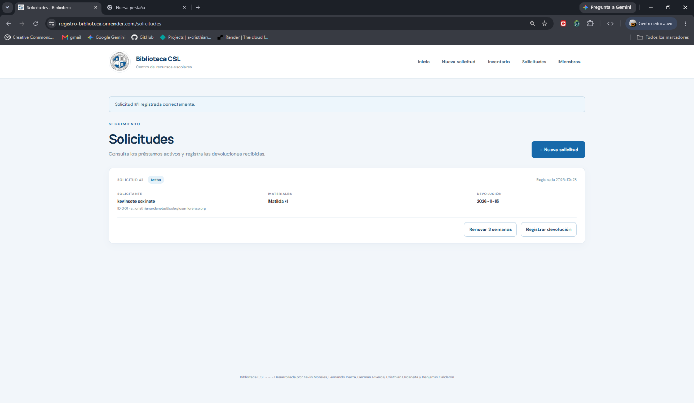

# Biblioteca CSL — Centro de recursos escolares

Biblioteca CSL es una aplicación web para administrar los recursos de una biblioteca escolar desde un solo lugar. Permite consultar y ampliar el inventario, registrar a estudiantes, docentes y funcionarios, gestionar solicitudes de préstamo, controlar fechas de devolución y conservar el historial de movimientos. Su interfaz adaptable facilita el uso desde computadores y teléfonos.

El proyecto está desarrollado para el Centro de Recursos Escolares del Colegio San Lorenzo. La aplicación valida los correos institucionales, controla la disponibilidad antes de confirmar un préstamo y ofrece una opción de renovación para apoyar el seguimiento de los materiales.

## Captura de la aplicación

Vista de la sección de solicitudes, donde se consultan los préstamos y se registran renovaciones y devoluciones:



## Tecnologías utilizadas

- **Python 3.10 o posterior** como lenguaje de programación.
- **Flask 3.1** para la aplicación web y sus rutas.
- **SQLite** para guardar inventario, miembros, préstamos y materiales asociados.
- **HTML, CSS y JavaScript** para la interfaz adaptable y sus interacciones.
- **Jinja** para generar las páginas a partir de plantillas.
- **Gunicorn** como servidor WSGI para el despliegue en producción.
- **SMTP** opcional para enviar recordatorios de devolución por correo.

## Funcionalidades

- **Inicio:** resumen de unidades disponibles, préstamos activos y miembros registrados.
- **Solicitudes de préstamo:** registro de préstamos para miembros activos, con correo institucional, materiales disponibles y fecha de devolución. Se permite solicitar hasta tres objetos y el plazo inicial máximo es de tres semanas.
- **Inventario:** consulta de materiales y disponibilidad, búsqueda y filtrado por categoría, y formulario para agregar materiales y cantidades.
- **Miembros:** registro de estudiantes, docentes y funcionarios con ID correlativo; permite dar de baja y reactivar miembros sin perder el historial. Solo acepta el dominio institucional configurado.
- **Renovaciones:** cada préstamo activo se puede renovar una vez por tres semanas; al renovarlo se reinicia su recordatorio de devolución.
- **Devoluciones:** permite marcar un préstamo activo como devuelto y actualizar la disponibilidad de sus materiales.
- **Recordatorios por correo:** comando para enviar avisos SMTP de préstamos cuya devolución se aproxima.
- **Protección de formularios:** validación CSRF en las operaciones que modifican datos.

El inventario inicial contiene doce registros ficticios para demostración. Deben reemplazarse o complementarse con los materiales reales antes de usar el sistema como inventario oficial.

## Rutas de la aplicación

| Ruta | Descripción |
|---|---|
| `/` | Inicio y resumen de la biblioteca |
| `/solicitud` | Formulario para solicitar materiales |
| `/inventario` | Consulta, búsqueda y registro de materiales |
| `/miembros` | Directorio y registro de miembros |
| `/solicitudes` | Seguimiento de préstamos y devoluciones |
| `/solicitudes/<id>/renovar` | Renovación de un préstamo activo |
| `/solicitudes/<id>/devolver` | Registro de devolución |
| `/miembros/<id>/estado` | Baja o reactivación de un miembro |

Las rutas para renovar, devolver y cambiar el estado de un miembro reciben solicitudes `POST` y están protegidas con token CSRF.

## Base de datos

La aplicación utiliza SQLite y crea la base de datos automáticamente al iniciar. De forma predeterminada, el archivo queda en `instance/biblioteca.sqlite3`. La ruta puede cambiarse con la variable de entorno `BIBLIOTECA_DATABASE`.

La base de datos contiene estas tablas:

- `inventory`: materiales, categorías, descripción o modelo, cantidad total y unidad.
- `members`: identificador, nombre, tipo, correo institucional y estado activo.
- `loans`: miembro solicitante, correo para notificaciones, fechas, estado del préstamo y renovación.
- `loan_items`: materiales y cantidades asociadas a cada préstamo.

Al iniciar, la aplicación crea las tablas que falten y añade los campos compatibles con las versiones anteriores de la base de datos. El inventario de ejemplo se inserta sin duplicar registros existentes.

## Estructura del proyecto

```text
registro_biblioteca/
├── app.py                    # Aplicación Flask, rutas, base de datos y comando de correo
├── requirements.txt          # Dependencias de ejecución
├── testing.txt               # Lista de mejoras y requisitos de referencia
├── README.md                 # Documentación del proyecto
├── instance/
│   └── biblioteca.sqlite3    # Base SQLite local (se crea al iniciar)
├── templates/                # Plantillas HTML renderizadas por Jinja
│   ├── base.html
│   ├── index.html
│   ├── inventory.html
│   ├── members.html
│   ├── new_loan.html
│   └── requests.html
├── static/
│   ├── css/style.css         # Estilos adaptables
│   ├── js/app.js             # Interacciones de la interfaz
│   └── img/                  # Logotipo del colegio
├── docs/
│   └── captura-solicitudes-nueva.png
└── tests/
    └── test_app.py           # Pruebas automatizadas
```

## Ejecución local

Requiere Python 3.10 o posterior. Desde la carpeta del proyecto, ejecuta en PowerShell:

```powershell
py -m venv .venv
.\.venv\Scripts\Activate.ps1
pip install -r requirements.txt
flask --app app run --debug
```

Abre <http://127.0.0.1:5000>. También puedes iniciar el servidor integrado con `py app.py`.

## Despliegue en Render

1. Sube el proyecto a un repositorio Git y crea un **Web Service** en Render conectado a ese repositorio.
2. Selecciona **Python** como entorno y configura:
   - **Build Command:** `pip install -r requirements.txt`
   - **Start Command:** `gunicorn app:app`
3. En **Environment**, configura `FLASK_SECRET_KEY` con un valor secreto aleatorio. Opcionalmente, define `INSTITUTIONAL_EMAIL_DOMAIN` si el dominio institucional es distinto de `@colegiosanlorenzo.org`.
4. Para conservar los datos SQLite entre reinicios y nuevos despliegues, agrega un disco persistente al servicio, por ejemplo montado en `/var/data`, y define `BIBLIOTECA_DATABASE` como `/var/data/biblioteca.sqlite3`.
5. Despliega el servicio y abre la URL que Render proporciona.

> **Persistencia:** el sistema guarda la información en SQLite. En un servicio en la nube, configura un disco persistente y apunta `BIBLIOTECA_DATABASE` a ese disco; de lo contrario, los datos pueden perderse al reiniciar o volver a desplegar el servicio.

## Recordatorios por correo (opcional)

Configura estas variables de entorno para habilitar el envío: `MAIL_HOST`, `MAIL_PORT`, `MAIL_USERNAME`, `MAIL_PASSWORD` y `MAIL_FROM`. En PowerShell, por ejemplo:

```powershell
$env:MAIL_HOST = "smtp.example.cl"
$env:MAIL_PORT = "587"
$env:MAIL_USERNAME = "cuenta@example.cl"
$env:MAIL_PASSWORD = "contraseña-de-aplicación"
$env:MAIL_FROM = "Biblioteca <cuenta@example.cl>"
$env:INSTITUTIONAL_EMAIL_DOMAIN = "@colegiosanlorenzo.org"
flask --app app send-reminders --days 2
```

El comando `flask --app app send-reminders --days 2` envía recordatorios para préstamos con fecha de devolución dentro de los próximos dos días. Puede programarse para ejecutarse diariamente. Sin configuración SMTP, la gestión de préstamos sigue funcionando, pero no se envían correos. No guardes credenciales en el repositorio.

## Pruebas

Ejecuta la suite automatizada desde la carpeta del proyecto:

```powershell
py -m unittest discover -s tests
```

## Seguridad y uso

La aplicación no incluye autenticación ni control de permisos para la gestión del staff. Antes de publicarla en una red abierta, incorpora inicio de sesión y autorización para proteger datos personales y operaciones de administración. En producción, configura siempre `FLASK_SECRET_KEY` y utiliza HTTPS.

## Equipo

- Benjamín Calderón
- Germán Riveros
- Cristhian Urdaneta
- Fernando Ibarra
- Kevin Morales
